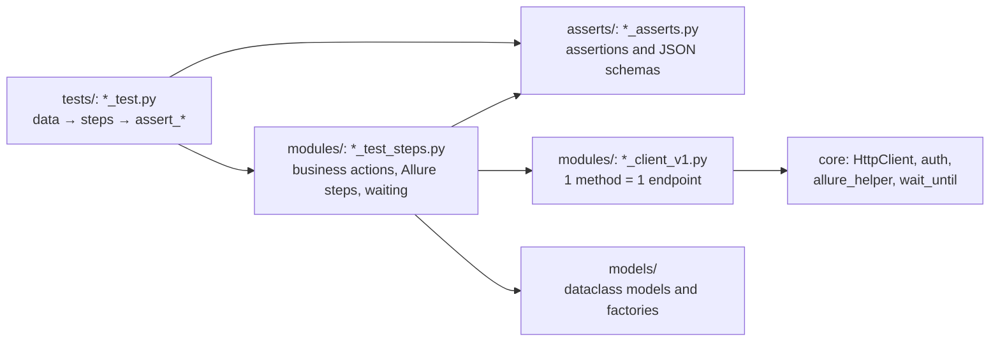

# pytest-integration-tests

[Русская версия](README.ru.md)

Two [Agent Skills](https://agentskills.io) that make Claude write Python integration tests the way an experienced QA automation engineer does: in layers, with an Allure report that explains a failure without reading code, and with fixtures that are safe for parallel runs. A working example project comes along, built straight from the skills and checked in CI.

## Contents

- [Why](#why)
- [What is inside](#what-is-inside)
- [Installation](#installation)
- [Usage](#usage)
- [Architecture](#architecture)
- [What the report looks like](#what-the-report-looks-like)
- [Key decisions](#key-decisions)
- [Example project](#example-project)
- [How the repository is checked](#how-the-repository-is-checked)
- [Compatibility](#compatibility)
- [Adapting to your project](#adapting-to-your-project)
- [Limitations](#limitations)
- [Contributing](#contributing)
- [License](#license)

## Why

Without rules an agent writes tests "somehow": `requests` right in the test, `time.sleep` instead of waiting, `assert r.status_code == 200` without context, a token for the whole session without refreshing. Such tests are hard to read, flaky in parallel runs, and the report does not answer "what broke".

The skills describe an architecture that holds a large real-world integration suite: several services, API, UI and Kafka events, scheduled CI runs with Allure TestOps. Everything specific to one company is removed, so it fits any project:

- a test reads like a business scenario: data → steps → assertions;
- the Allure report shows the steps, requests and responses, the waiting history and the failure category;
- tests are independent and run in N workers on any environment;
- the infrastructure lives in one place and is the same in every project.

## What is inside

| Skill | Triggers on | Gives the agent |
| --- | --- | --- |
| [`pytest-integration-tests`](skills/pytest-integration-tests/SKILL.md) | "write an autotest", "cover the endpoint with tests", a shared OpenAPI spec, a failed or flaky test, a test review | layers and rules, templates of a test, steps, a client, a model, assertions and fixtures, Allure and xdist rules, mapping to a project built differently, a flaky test procedure, a checklist; UI and Kafka in `references/` |
| [`pytest-integration-bootstrap`](skills/pytest-integration-bootstrap/SKILL.md) | a new test project, a new job, fixing timeouts, tokens, the report or CI | the core as real files in `templates/` and `scripts/scaffold.py`, the decisions behind it, CI for GitLab and GitHub with optional Allure TestOps, a table of common breakages |

```text
pytest-integration-tests/
├── .claude-plugin/              Claude Code plugin and marketplace
├── skills/
│   ├── pytest-integration-tests/
│   │   ├── SKILL.md             writing tests (loaded most often)
│   │   └── references/          ui.md, kafka.md (loaded only when needed)
│   └── pytest-integration-bootstrap/
│       ├── SKILL.md             creating and repairing the core
│       ├── templates/           the core: modules/, asserts/, conftest.py, config, CI
│       └── scripts/scaffold.py  copies the core into a project, never overwrites
├── example/                     a working project built from the skills + a demo stand
├── tools/
│   ├── build_example.py         builds example/ from the skills (or compares: --check)
│   ├── verify.py                starts the stand, runs the tests, checks the report
│   ├── kafka_check.py           the Kafka listener against a real broker
│   └── package_skills.py        skill zips for the Claude app
└── .github/workflows/           verify on push and pull request, release on a tag
```

There are two skills because the core is needed rarely: when a project is created or the infrastructure is repaired. The main skill loads every time a test is written and does not drag hundreds of lines of infrastructure along. The core is not retyped by the agent from Markdown: the script copies it.

## Installation

### Claude Code: as a plugin (recommended)

```bash
claude plugin marketplace add OWNER/pytest-integration-tests
claude plugin install pytest-integration-tests@pytest-integration-tests
```

The same inside a session: `/plugin marketplace add OWNER/pytest-integration-tests`, then `/plugin install pytest-integration-tests@pytest-integration-tests`. Updates come from the marketplace, the version is in `.claude-plugin/plugin.json`.

The skills trigger by the task description. To call one by hand: `/pytest-integration-tests:pytest-integration-tests` or `/pytest-integration-tests:pytest-integration-bootstrap`.

### Claude Code: without the plugin

```bash
git clone https://github.com/OWNER/pytest-integration-tests.git
# for all projects on this machine:
cp -r pytest-integration-tests/skills/* ~/.claude/skills/
# or into the test repository, so the whole team has them (and commit):
cp -r pytest-integration-tests/skills/* path/to/your-tests/.claude/skills/
```

### The Claude app (claude.ai and desktop)

1. Download `pytest-integration-tests.zip` and `pytest-integration-bootstrap.zip` from Releases or build them: `python tools/package_skills.py` (they appear in `dist/`).
2. Open Customize → Skills, press "+", then Create skill → Upload a skill, and upload each archive.

Skills need code execution to be enabled ([help](https://support.claude.com/en/articles/12512180-use-skills-in-claude)).

### Other agents

The skills follow the open [Agent Skills](https://agentskills.io) standard: the frontmatter has only the portable fields `name`, `description` and `license`. Tools that support the standard pick them up. Elsewhere `SKILL.md` is plain Markdown that can be connected as project rules, and `scaffold.py` is a standalone Python script.

## Usage

| Request | What the agent does |
| --- | --- |
| "Cover POST /orders with tests, here is the swagger" | reads the project's conventions and neighbouring tests; adds a client method, steps, assertions with a response schema, a positive test and a parametrized negative one, a marker in `pytest.ini`; runs `--collect-only`, `ruff` and only the new tests if an environment is available |
| "Set up integration tests for the payments service: dev and stage, Keycloak, UI needed" | asks what is missing (authorization, CI, TestOps), runs `scaffold.py`, fills in `config.yml`, `.env.example`, writes the first test and checks the report |
| "Tests start failing with 401 after 10 minutes" | finds the cause in the breakages table (a token without refresh) and moves `TokenAuth` over without breaking the signatures the tests use |
| "This test is flaky in CI" | follows the procedure: the report category, a single run, `-n 4`, repeats, then fixes the cause in its layer |
| "Review tests/payments/" | goes through the checklist and the layer rules |

In an existing project its conventions win over the skill. The agent first reads `CLAUDE.md`, `pytest.ini`, `conftest.py` and neighbouring tests and takes from the skill only what the project lacks. It does not rewrite the core unasked, and in a project with another HTTP wrapper, assertion helpers or no Allure it maps the rules onto what is there.

## Architecture



| Layer | May use | May not |
| --- | --- | --- |
| test | steps, assertions, model factories, fixtures, `mutate` | clients, `requests`, `allure.attach`, `assert`, `if`/`for`/`sleep`/`try` |
| steps | clients, models, assertions (for preconditions), `wait_until` | `requests`, `allure.attach` |
| client | `HttpClient`, `get_auth` | `allure.step`, `assert`, business logic |
| assertions | `allure_helper`, schemas | clients, steps |

`ruff check .` enforces part of the table in a scaffolded project. When the API changes, one client changes. When the scenario changes, the steps change. The test stays readable and the report is the same in every test.

A test:

```python
pytestmark = [pytest.mark.contracts, allure.epic("Contracts"), allure.feature("Contract creation")]


@allure.story("Successful creation")
@allure.title("A created contract is saved as sent")
def test_create_contract_saves_fields(cfg, f_cleanup):
    """GET /contracts/{id} returns the created contract with the same fields as in the request."""
    contract = ContractSteps(cfg, plan="premium", termMonths=24)
    f_cleanup(contract)

    assert_contract_created(contract.try_create())
    assert_contract_saved(contract.get(), contract.model)


@allure.story("Validation")
@allure.title("Contract creation: {param_id} -> 400")
@pytest.mark.parametrize("change, field", [
    pytest.param(mutate("number"), "number", id="no number"),
    pytest.param(mutate("planId", "not-a-uuid"), "planId", id="planId is not a UUID"),
])
def test_create_contract_validation(cfg, f_cleanup, change, field):
    """An invalid body is rejected with 400 and an error for the field."""
    contract = ContractSteps(cfg)
    f_cleanup(contract)

    response = contract.try_create(body=change(contract.body()))

    assert_validation_error(response, field)
```

## What the report looks like

The step tree of the example:

```text
A created contract is saved as sent                       epic: Contracts › feature: Contract creation
  ▸ Creating contract AT-e73c82f955
      📎 POST to http://127.0.0.1:8099/api/v1/contracts          request body, secrets masked
      📎 Response with status code 201 (0.00 s) x-request-id=…   response body
  ▸ Checking: Contract creation -> 201
  ▸ Checking the structure against the schema "contract creation response"
  ▸ Getting contract AT-e73c82f955
      📎 GET to http://127.0.0.1:8099/api/v1/contracts/720ad5af-…
      📎 Response with status code 200 (0.00 s) x-request-id=…
  ▸ Checking: Getting the contract -> 200
  ▸ Checking that contract fields match what was sent
      📎 Comparison: contract fields                             OK / MISMATCH per field

A created contract is processed and becomes ACTIVE
  ▸ Creating contract AT-dcb6f63c9a
  ▸ Waiting: contract AT-dcb6f63c9a in status ACTIVE (up to 15 s)
      📎 Polling history, attempts: 3                            the status at every attempt
      📎 Response with status code 200 (0.00 s)                  the last response
```

Also in the report:

- **description**: the test docstring; **parameters**: readable (`without number`); titles of parametrized tests use the parameter ids (`Contract creation: no number -> 400`);
- **environment**: the environment, service URLs, the commit of the tests;
- **categories**, the first match wins:

| Category | When |
| --- | --- |
| Environment unavailable | connection errors and timeouts, a gateway 502/503/504, the token server is down (broken) |
| Timed out waiting for a state | `wait_until` did not get the state in time (failed) |
| Product defects | an assertion failed, including a non-JSON body or a missing field (failed) |
| Test defects | the test could not run: an error in its code or data (broken) |

Categories match exception class names, not message texts, so messages can be translated freely. A failed UI test has a screenshot and `trace.zip` in Tear down: `playwright show-trace trace.zip`.

## Key decisions

1. **A test knows nothing about HTTP.** It calls only steps and `assert_*`. The client is a thin wrapper over endpoints, business actions live in the steps. An API change touches one file.
2. **A steps object = an entity of the test, the client is its field.** `ContractSteps` holds the model and the id. Two methods per action: `try_create()` returns the raw response when the action is what the test checks; `create()` is a precondition that fails right there with a clear reason. Steps never index into a response, so a strange product answer is reported by an assertion, not by a KeyError.
3. **Assertions only in `asserts/`, failed apart from broken.** Every assertion is a "Checking ..." step with "expected / got / the start of the response". `AssertionError` is a product defect, anything else an environment or test problem; 502/503/504 raise `EnvironmentUnavailable`.
4. **One HTTP client.** Every request has a timeout. A failed connection is retried for any method; 502/503/504 only for GET/HEAD/OPTIONS, because a repeated POST, PUT or DELETE may run a business action twice. `Retry-After` is ignored so that a maintenance page does not hang the run. Two attachments per call, secrets masked in any key style, in form bodies, query strings and assertion messages.
5. **Authorization by profiles, the token in a cache.** OAuth2 (password / client_credentials, any IdP), Basic, API key or none, with names of environment variables instead of secrets. The token is cached per process by the whole request form and refreshed before expiry.
6. **Waiting is one `wait_until`.** One step with the polling history and the last response instead of a step per attempt, also when the wait breaks.
7. **Data: dataclass + `default_factory`, variants are factories.** Dates and random values are generated per instance. Negative cases are mutations of a valid body. Timestamps are compared through a normalizer: servers reformat them.
8. **Parallel runs.** An expensive precondition is a session fixture with `xdist_group` and `--dist loadgroup`, and it cleans up after itself. What a test creates is deleted by a registry fixture, also in negative tests.
9. **Config and secrets.** Environments in `config.yml`, selected with `--env` (no default, so nothing runs against an environment by accident). Secrets in `.env` locally and in CI variables with the same names.
10. **UI.** Own fixtures instead of pytest-playwright: a browser per worker (chromium, firefox or webkit), a clean context per test, a trace only on failure. Locators: test id → role and label → text.
11. **Kafka.** The listener starts at the current end of every partition without a consumer group or commits, fails at once on a missing topic, keeps undecodable messages as bytes. Sending waits for the broker's acknowledgement.

## Example project

`example/` is a project built from the skills plus a demo stand on the Python standard library: a contracts service, a token server and a sign-in page.

```bash
cd example
python -m venv .venv && source .venv/bin/activate
pip install -r requirements.txt
python -m playwright install chromium
cp .env.example .env
python demo_stand/server.py                 # in another terminal
pytest -n 3 --alluredir allure-results --clean-alluredir
allure serve allure-results
```

`pytest demo_failures -n 2 --alluredir allure-results` adds failures on purpose, one per report category. More, including which files are generated from the skills: [example/README.md](example/README.md).

## How the repository is checked

The skills are the single source of truth; the example is built from them:

- `python tools/build_example.py` copies the core from `templates/` and the code blocks with a file path in the first line (`# modules/contracts/contract_client_v1.py`) from the main skill into `example/`; `--check` only compares;
- `python tools/verify.py` (or `--skip-ui` without a browser) compares the example with the skills, runs ruff, starts the demo stand, runs the tests in three workers and then checks the report: environment and categories, readable parametrized titles, at most one token per worker, no demo secret anywhere in `allure-results`, a GET surviving two 503s and a POST sent exactly once. The failures on purpose must land in their categories, and the failed UI test must attach a screenshot and a trace;
- GitHub Actions: `verify` on every push to main and on pull requests (Python 3.10 and 3.12, a scaffolded project without UI and Kafka, the Kafka listener against a real `apache/kafka` broker, `claude plugin validate`); `release` on a `v*` tag runs the same checks, requires the tag to match the plugin version and attaches the skill zips.

## Compatibility

- Python 3.10+.
- Checked: Python 3.13, pytest 9.1, allure-pytest 2.13.5, pytest-xdist 3.6.1, Playwright 1.63, jsonschema 4.26, requests 2.34. CI adds Python 3.10 and 3.12.
- Reports: Allure Report and Allure TestOps (through `allurectl watch`). `@allure.id` only in TestOps, and never invented.
- Context in Claude Code: the main skill loads its SKILL.md; `references/` and the core templates are read only when the task needs them.

## Adapting to your project

- **Language.** The skills and the core are in English. The agent writes steps, titles, docstrings and messages in the project's language; in a new project it asks once. Categories do not depend on the language.
- **Names and structure.** If the project has other folders, suffixes or a fixture format (for example `f_<domain>.py` + `pytest_plugins`), the agent follows the project.
- **Another framework.** A project with its own HTTP wrapper, assertion helpers or no Allure keeps them; the skill maps its rules onto them and does not migrate the project as a side effect.
- **Authorization.** A new kind is a class with a `headers()` method and a branch in `get_auth`: an mTLS header, a signed request.
- **Without TestOps.** `allure generate` and publishing in CI. For trends copy `history/` of the previous report into `allure-results/history` before generating.
- **Without UI or Kafka.** `scaffold.py --without ui kafka`.

## Limitations

- The Kafka listener is checked against a single local broker in CI; SASL/SSL settings are not exercised.
- The demo stand is simplified: it shows the mechanics, not a real service.

## Contributing

1. Edit the skills: rules in `SKILL.md`, the core in `templates/`, domain templates in the code blocks of the main skill.
2. `python tools/build_example.py` to bring the changes into the example.
3. `python tools/verify.py` to check that everything works.
4. A pull request. For a release raise `version` in `.claude-plugin/plugin.json`, add to `CHANGELOG.md` and push the tag `vX.Y.Z`.

Ideas and bugs go to Issues.

## License

[MIT](LICENSE) © 2026 Eduard Khakimov
